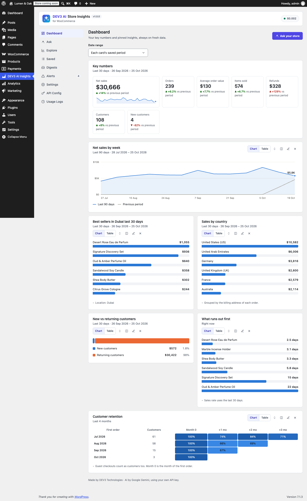

# DEV3 AI Store Insights for WooCommerce

Ask your WooCommerce store questions in plain English and get charts, AI explanations, pinned dashboards, email digests and anomaly alerts.



## Features

Type "best sellers in Dubai last month" and get a clean chart, the table behind it and a short explanation.

DEV3 AI (Google AI, your own API key) reads the question and picks one report from a fixed library of safe, parameterised reports. It only fills in typed options such as the period, the measure or a location. The model never writes database queries, and every option is checked again before the report runs.

Everything also works without AI. Built-in rules understand the common questions, and Explore lets you build any report by hand.

### Reports
* Store summary: net sales, orders, average order value, items sold, refunds, customers and new customers, each with a change against the previous period or the same period last year
* Sales trend by day, week, month, quarter or year
* Top products and top categories, ranked by revenue, quantity or orders
* Sales by country, region/state or city
* New vs returning customers, registered vs guest customers
* Top customers
* Refunds over time and the most refunded products
* Monthly customer cohorts, showing retention or revenue
* Stock: low stock, out of stock, days of stock left and overstock
* Top coupons
* Filters: location, product category, product, customer type and account type
* Periods: presets or a custom date range, in your site's timezone and week start

### Store owners also get
* Saved questions and a dashboard of pinned insights, with one date range for every card
* Scheduled e-mail digests (daily, weekly or monthly), with a preview, a test send and an optional DEV3 AI summary paragraph
* Anomaly alerts: daily checks against a 28-day baseline. Each alert shows the products and countries that moved most, can be explained by DEV3 AI and can be sent by e-mail. A "best sellers about to run out" stock alert is included. DEV3 AI can suggest alert rules, and nothing is saved until you accept them.
* CSV export of any report
* A WordPress dashboard widget
* Light and dark themes. Charts are accessible: keyboard navigation, tooltips, a table view and colour-blind-safe palettes.
* HPOS and Cart/Checkout blocks compatible. Reports read the WooCommerce Analytics tables. A data health check imports any order the Analytics tables missed.

## Requirements

- WordPress 6.0 or newer (tested up to 6.8)
- PHP 7.4 or newer
- WooCommerce 8.0 or newer (required)
- Optional: your own Google AI API key (from Google AI Studio) to switch on the DEV3 AI features. The rest of the plugin works without one.

## Installation

### From the release zip

1. Download `dev3-ai-store-insights-for-woocommerce.zip` from the [latest release](https://github.com/dev3tech/dev3-ai-store-insights-for-woocommerce/releases/latest).
2. In WordPress, go to **Plugins → Add New → Upload Plugin**, choose the zip and click **Install Now**.
3. Click **Activate**.

### Build from source

```bash
git clone https://github.com/dev3tech/dev3-ai-store-insights-for-woocommerce.git
cd dev3-ai-store-insights-for-woocommerce
composer install --no-dev
npm ci
npm run build
```

Then copy the `dev3-ai-store-insights-for-woocommerce` folder into `wp-content/plugins/` and activate it.

### Getting started

1. Upload the zip in Plugins > Add New > Upload Plugin and activate it. WooCommerce 8.0+ must be active.
2. Open **DEV3 AI Insights** in the admin menu.
3. Optional: add your Google AI API key in **API Config** to enable DEV3 AI.

## FAQ

### Does the AI see my customers' data?
DEV3 AI receives your question plus aggregated report rows. E-mail addresses are never sent. Customer names are replaced with "Customer 1, 2…" unless you allow names in Settings.

### Can the AI break or change my data?
No. The AI can only choose a report and its options. Reports are read-only and run as prepared statements.

### Do I need an API key?
No. Without a key, questions are answered by the built-in rules, and explanations are short summaries the plugin writes itself.

### My numbers look low
WooCommerce fills its Analytics tables in the background. Settings > Data health shows any missing orders and can import them.

## Privacy

When DEV3 AI is enabled, questions and aggregated report data are sent to Google AI under your own API key. The plugin adds a suggested text to your privacy policy, plus a personal-data exporter and eraser for each user's question history.

## Documentation

The full HTML guide (installation, settings, hooks and FAQ) is in [`docs/index.html`](docs/index.html). Open it in a browser after cloning or downloading the repository.

## Changelog

### 1.0.0
* Initial release.

## Licence

Released under the GNU General Public License v2.0 or later (GPL-2.0-or-later). See [LICENSE](LICENSE).

## More from DEV3

- [DEV3 AI Store Insights for WooCommerce on the DEV3 Marketplace](https://www.dev3.tech/item/dev3-ai-store-insights-for-woocommerce)
- [More WordPress plugins, themes and templates from DEV3](https://www.dev3.tech/marketplace)
